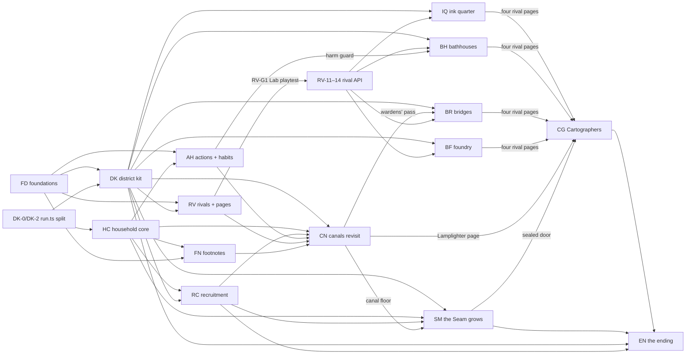

# Roadmap and backlog

> Updated 2026-10-23: **every decided design now has an implementation plan**, ordered in §2 (the build program). Earlier the same day: the roster and footnotes rounds and a design consistency pass; on 2026-10-22 the household and district rounds; on 2026-10-21 the growing-pages build.
> Current references: [DESIGN.md](../DESIGN.md), [rune rules](design/rune-design-final.md), [party](design/party.md), [districts](design/city-and-districts.md), [rivals](design/rivals.md). Evidence and plan deviations: [rune audit](plans/rune-redesign-audit.md).

## How to use this doc

- IDs are stable: move entries, never renumber. New IDs start after BL-131 (BL-127 district kit, BL-128 foundations, BL-129–131 the household split of BL-43).
- Sections: [1 Now](#1-now-correctness-and-plan-leftovers), [2 Build program](#2-build-program-order-of-execution), [3 Backlog](#3-backlog-ideas-ready-to-pick), [4 Tech](#4-tech-and-tooling), [5 Parked](#5-parked-cut-or-deferred), [6 Questions](#6-open-design-questions), [7 Done](#7-done-log).
- An item gets a focused design round when needed, then an implementation plan. Items a plan absorbed point at it ("→ FD-6"); they leave this doc when that task merges. Update design/technical decisions with the build and move completed work to the Done log.
- No standalone playtest tasks: the player supplies feedback when they choose; record resulting changes against the relevant item. `needs-feedback` means a decision depends on that feedback.
- Types: feature, content, design, balance, polish, bug, tech, test, docs. Sizes: XS (one edit), S (focused task), M (several related tasks), L (own plan), XL (several plans). Estimates are scope, not promises about model usage.
- Status: ready, needs-design, needs-feedback, investigate, idea, blocked, parked. An investigation must reproduce the issue before changing rules. Table Area fields remain searchable.

## 1. Now: correctness and plan leftovers

Every item here is now inside a plan (§2), noted in its status; they run in Stage 0–1.

| ID | Work | Type / size | Area | Status / dependencies | Concrete scope |
|---|---|---|---|---|---|
| BL-101 | Fine-print coverage audit and missing content | content / M | runes, codex | ready **→ FN-1A, FN-9, FN-10** | 100 registered lines versus P4's stated 132. Inventory actual missing behavior by rune; add useful sentences with firing scenarios. Do not promise 6–8 lines per rune or fabricate rows to hit a quota. Extend toward 220 as districts add terrain. |
| BL-102 | Bench scene parity with encountered content | feature / M | bench | ready **→ DK-14** | Support met canal foes, water/current, vents and compounds; update subject counting and painting. Preserve discovery gates and the three-subject limit. Add a reusable authored trial lattice for nested inventions if the generated trial cannot demonstrate them. |
| BL-104 | Keep solvent discoveries after spending them | bug / S | codex, save | ready **→ FN (solvent discovery)** | Record found solvents separately from inventory; retain pages at zero stock. Method/solvent pages should expose their witnessed fine print. Define existing-v7 inference from stock/inventions/witnessing. |
| BL-105 | Preserve intended delayed invention context | bug / M | runes | investigate **→ FD-2, FD-4** | Regress Coil/Margin on Repeat/Wick/Filings and nested Wick wake flags. Decide whether repeated flavored actions retain widening; preserve one-shot scheduling and lifetime attribution. |
| BL-106 | Dusk jar replacement timing | bug / S | combat | investigate **→ FD-2, FD-5** | Snapshot jar identities, not just coordinates, so a replacement jar waits until next dusk. Reproduce using a jar tail replacing a later queued dusk jar. |
| BL-107 | Stop state mutation when a cast fizzles at the cap | bug / M | combat | investigate **→ FD-2, FD-6** | Audit helper loops and detached continuations after the 500-event cap; require termination and projected/final state agreement. |
| BL-108 | Current arrival hooks and playback agreement | bug / M | combat | investigate **→ FD-1, FD-3** | Define/reproduce arrival into stains, marks, fire and step jars for carried units/cargo. Include history/origin of delayed effects and exemptions for water/flying/anchored foes. |
| BL-119 | Canal lock map illustration | polish / XS | world | ready **→ CN-11** | Replace the cosmetic burnt wooden gate with an opened rat-guarded lock; current puzzle teaches a drop, not burning a gate. Can ship alone or with BL-124. |

## 2. Build program: order of execution

Every decided design now has an implementation plan (2026-10-23). [build-program.md](plans/build-program.md) is the boundary map (which plan owns which system), the reconciliation notes and the defaults taken for the player to veto. Each plan is executed with the `implement` skill and gets its own `<plan>-status.md` when it starts. Task IDs carry the plan's prefix (`DK-2`, `HC-4`), so dependencies below point at real tasks.

**Plan status:** *planned* (reconciled, not started) · *ready* (every dependency merged) · *building* · *gate* (waiting on a playtest) · *done*. A **gate** is a player playtest named in the plan; work past a gate waits for it, everything else keeps going.

### 2.1 Stages

Stages are an order, not barriers: a task starts as soon as the tasks it depends on are merged, so stages overlap. The critical path runs through the platform (DK, FD, HC, RV) to the first district.

| Stage | What gets built | Tasks | Ends with |
|---|---|---|---|
| **0 · Groundwork** | Golden event-log baseline and the behaviour-neutral split of the trip flow out of `run.ts`; foundations contracts, the movement × hook test matrix and the bug repros; household types; the fine-print audit | DK-0, DK-2 · FD-0, FD-1, FD-2, FD-8, FD-9, FD-10 · HC-W0 · FN-1A | Everything after can edit disjoint files |
| **1 · Platform core** | The arrival pipeline and correctness fixes; the district kit's contracts and hooks; the household profile, save reset (v9), start points and party of 1–3; the rival engine with the Lamplighter in the Lab; the footnote system | FD-3–FD-7, FD-11 · DK-1, DK-3–DK-10 · HC-1–HC-6 · RV-W0–RV-10 · FN-0–FN-12 | **Gate RV-G1**: the Lamplighter Lab playtest |
| **2 · Platform complete** | Kit screens and the port proof; the household shelf; Pull, Hop, Swap and the seven habits; recruits, hidden-until-ready and door arrivals; the rival authoring API and recovered pages; the Seam footnote content; the bot made reusable for the ending's generator | DK-11–DK-18 · HC-7–HC-9 · AH (all) · RC (all) · RV-11–RV-20 · FN-A1–FN-C9 · EN-0 | **Gates**: household (HC), actions (AH), recruits (RC), footnote thresholds (FN-P1) |
| **3 · Revisits** | The canals at the new standard (runaway, the Lamplighter in room 4, barge cargo, re-laid rooms, Timing footnotes); the Seam's Marginalia, re-laid rooms and reachable hearings; the lower Seam with the canal floor | CN (all) · SM Waves 1–2 | **Gates**: CN-P1, SM G1, SM G2. First playable trio |
| **4 · Middle districts** | The ink-makers' quarter, the bathhouses, the bridges and the bell foundry, **in any order and in parallel** (each owns its files). Each ships first on a scripted stand-in heart, then its real rival after RV-14, then its footnote batch and its lower-Seam floor | IQ · BH · BR (needs CN-8, the wardens' pass) · BF | Each district's playtest gates; four real masters = four recovered pages |
| **5 · The Cartographers' hall** | Pencil and ink, the guild's hands, free return then the final run, the Registrar, the five-page hearing, the owner's door | CG (all), SM-10 (the sealed door) · SM Wave 3 (answering margins) | **Gates** CG-G1, CG-G2, CG-G4 |
| **6 · The ending** | The generator spike can run as soon as the kit's port proof lands (Stage 2–3) to de-risk early; then the drawing table, each district's heart frame as it lands, the owner and the handover | EN-S1 → **EN-G0**, then EN Waves 2–5 | The credits; the sandbox open |

### 2.2 Dependencies between plans

### 2.3 Plans

| Roadmap | Plan | Status | Size (tasks) | Needs before it starts | Unlocks | Gates |
|---|---|---|---|---|---|---|
| BL-128 | [Foundations](plans/foundations-plan.md) (FD): arrival pipeline, event contracts, BL-105–109, BL-112, BL-123 | **building** ([status](plans/build-program-status.md)) | ~2 L (12) | — | AH (FD-3, FD-7), DK-3/DK-4, RV-2/RV-3, FN-0 (FD-8/9), BR/CG Bind events (FD-9) | — |
| BL-127 | [District kit](plans/district-kit-plan.md) (DK): district modules, trip shape, rules, pieces, offers, hearing, out of the room, stand-ins, Bench parity (BL-102), thresholds (BL-94), map (BL-95), lore registry | **building** ([status](plans/build-program-status.md)) | ~L (20) | DK-0/2 none; DK-3/4 need FD-3; DK-5a/6 HC-W0; DK-7 RC-W0; DK-8/9 RV-W0 | every district plan (after DK-17), RC-4, RV-14 | — |
| BL-43 → BL-129 | [Household core](plans/household-core-plan.md) (HC): roster, save v9, shelf, slots, start points, party 1–3, shared ink | **building** | L–XL (10) | DK-2 for HC-1/HC-4 | AH, RC, FN-0, RV-15, CN, SM | HC playtest |
| BL-43 → BL-130 | [Actions and habits](plans/actions-habits-plan.md) (AH): Pull, Hop, Swap, seven habits, harm guard | **building** (AH-W0 done) | L (9) | HC-W0, FD-3, FD-7 | RC go-live of each recruit, CN (runaway), BH (towel-bearer) | AH Lab playtest |
| BL-43 → BL-131 | [Recruitment](plans/recruitment-plan.md) (RC): seven apprentices, recruit offer, hidden until ready, door arrivals | **building** (RC-W0 done) | M–L (10) | HC-W0, DK-1 | CN-6, each district's recruit placement | RC playtest |
| BL-30, BL-118 | [Rivals and recovered pages](plans/rivals-plan.md) (RV) | **building** (RV-W0, RV-1 done) | XL (21) | DK-1, FD-7, FD-5; RV-15 needs HC-1 | CN-7, every real district heart (RV-14), the five-page hearing (RV-15) | **RV-G1** Lamplighter Lab playtest |
| BL-54, BL-101, BL-104, BL-50 | [Footnotes](plans/footnotes-plan.md) (FN): system, audit, solvent discovery, diagonal capstone, Seam content | **building** (FN-1A done) | system L + ~9 M content (27) | FD-8, FD-9, HC-1 | every district's footnote batch (after FN-C1) | FN-P1 thresholds |
| BL-124, BL-91, BL-119 | [Canals revisit](plans/canals-revisit-plan.md) (CN) | **planned** | L (20) | DK-17, HC-2, RC-4, AH-1/AH-4; CN-7 needs RV-G1 | BR's key gate (CN-8), SM's canal floor, the Lamplighter's page | CN-P1 |
| BL-125 | [The Seam grows](plans/seam-grows-plan.md) (SM) | **planned** | L (16) | DK-17, DK-8, DK-9, HC-3, RC-3 | lower-Seam floors for each district, the sealed door CG opens | SM G1, G2, G3 (answer texts) |
| BL-113 | [Ink-makers' quarter](plans/ink-quarter-plan.md) (IQ) | **planned** | L + 2–3 M (33 rows) | DK-17, FD-3, HC-2; the postmaster RV-14 | the postmaster's page; Bind and Lift for the household | IQ-G1, IQ-G2 |
| BL-114 | [Bathhouses](plans/bathhouses-plan.md) (BH) | **planned** | XL (26) | DK-17, AH-W0 (harm guard); the Steward RV-14 | the Steward's page | BH-G1 |
| BL-115 | [Bridges](plans/bridges-plan.md) (BR) | **planned** | L + batch (22) | DK-17, FD-9, CN-8 (key); the Chief Warden RV-14 | the Chief Warden's page; Bind *pushed* | BR-G2 |
| BL-116 | [Bell foundry](plans/foundry-plan.md) (BF) | **planned** | L–XL (28) | DK-17; the Carillonneur RV-14 | the Carillonneur's page | BF-G1 |
| BL-117 | [Cartographers' hall](plans/cartographers-plan.md) (CG) | **planned** | L (21) | DK-17, FD-9, RV-14, RV-15; a campaign needs all four masters real | the owner's door (SM-10), the exile's Board pages, BL-126 | CG-G1, CG-G2, CG-G4 |
| BL-126 | [The ending](plans/ending-plan.md) (EN): the handover, the owner as the tenth apprentice, credits, the drawing table and pen, generated rooms with a bot test, drawn districts on the map — design [ending.md](design/ending.md) | **planned**; EN-0 (bot to `src/engine/sim/`) runs early, beside Stage 2 | L (24) | the generator spike EN-S1 needs DK-17 and EN-0; the full table needs SM-11, CG's door, RV-15, FN-1 and each district's heart frame | the credits; the sandbox | **EN-G0** generator go/no-go, playtest, campaign gate |

**Next action:** the program is building; live task state is in [build-program-status.md](plans/build-program-status.md).

### 2.4 Atmosphere (outside the program)

| ID | Work | Type / size | Area | Status | Scope |
|---|---|---|---|---|---|
| BL-40 | Real names | design / S | story | ready | Title, apprentices, city and Seam remain placeholders. |
| BL-41 | Owner's mystery and lore delivery | content / M | story, codex | **covered by the plans** | The channel is DK's lore registry (`Profile.papers`, DK §9) plus SM's answering margins; each district plan writes its own thread (CN lamp-ledgers, IQ letters, BH bather's ledger, BR mason's ledgers, BF the Seam's missing bell, CG the registry and the owner's desk) and EN writes the handover. Remaining: a read-through of the whole thread once the texts exist. |
| BL-42 | Audio | feature / M | audio | needs-design | Tone, free assets or synthesis, mute/reduced distractions and iOS gesture/PWA behavior. |

## 3. Backlog: ideas ready to pick

| ID | Work | Type / size | Area | Status | Scope |
|---|---|---|---|---|---|
| BL-100 | Rune art and editor polish | polish / M | runes, study | ready | Redraw margin, strike, coil, brink, bind, chalk, filings, quicksilver. Audit invention names/art in every shelf/caption and optional shelf metadata/duplicated flow geometry. Implementation leftovers now have their own IDs above and in §4. |
| BL-50 | Diagonal aura reach | feature / M | lattice, mastery | **decided as an aura capstone 2026-10-23**; needs BL-54 and readable overlays **→ FN-11, FN-12** | One of each aura's two capstones (Afterglow, Steep, Coil: also acts through diagonally touching cells); design the overlay in the same build. [Footnotes](design/footnotes.md) §1. |
| BL-51 | Additional runes beyond the 31 | content / M each | runes | idea | New Source/Shape/Trigger behavior only if it adds something current methods and wiring cannot express. Pull/hop as personal basic actions belong to BL-43 first. No aspect assignment needed. |
| BL-52 | More idioms (nine now) | content / S each | runes, codex | ready | Add recognizable event patterns in idioms.ts and a replayable Lab example; these are named achievements of a cast, not compile recipes or free Glyphs. |
| BL-56 | Attrition and build balance | balance / M | combat, run | needs-feedback | Separate isolated room strength from full-trip charge exhaustion. Baseline: starter bots clear fresh Seam rooms but full trips exhaust charges around depth 3. Review Strike versus Spark/crush, ink costs, leans and rewards. Decide whether pushing FROM oil should start a slide; currently only entering oil extends it. |
| BL-60 | More Seam layouts | content / S | run | ready | Three per depth now; vary network, jar and push opportunities rather than enemy HP alone. |
| BL-61 | Additional enemy behaviors | content / M | world, combat | **covered by the district plans** | Every district plan now designs its foes (IQ, BH, BR, BF, CG staff; CN's Lamplighter; SM's Marginalia), each with one telegraph. Reopen only for a foe a playtest asks for. |
| BL-62 | More loot offer kinds | content / S | run | idea | Current offers: rune/method pages, ink, solvents, vellum and doorway (key support exists). Avoid redundant currencies; recovered pages depend on BL-118. |
| BL-63 | Doorway variants / second rare offer | content / S | run | idea | Optional breaks in trip pacing with a clear cost in foregone loot. |
| BL-91 | Lamp-mother summoning cadence | balance / XS | combat | ready (decided 2026-10-22: nearest free lit lamp, every round) **→ CN-1** | The last summoned moth occupies the preferred lamp, often making calls every other round. [Canals §5b](design/city-and-districts.md) chose the designed every-round call at the nearest free lamp; confirm by playing. |
| BL-92 | Canal room tuning | balance / S | run | needs-feedback **→ CN-13** | Recalibrate with current runes/charges before using the old 39% heart result; room and full-trip metrics differ. |
| BL-93 | Current preview and arrows | polish / S | combat | needs-feedback | Current toggle exists; consider hold-to-peek and water arrows readable under oil/jars. |
| BL-94 | Threshold copy as district data | tech / XS | world | ready **→ DK-15** | Move banner copy into ThresholdDef before the next threshold room. |
| BL-95 | Map label/path spacing | polish / XS | world | ready **→ DK-16** | Recheck paths against the renamed Seam caption and expanding heard districts. |
| BL-71 | Reload the same Lab demo in-page | bug / XS | lab | investigate | Check the unchanged-id effect with ?demo=1; add a replay/reset path if still reproducible. |
| BL-73 | iPad / desktop layout verification | test / S | study, combat | idea | Cover larger screens and portrait/landscape; phone remains primary. |
| BL-74 | Player annotations in the notebook | feature / M | codex | idea | Automatic witnessed fine print is settled. Optional personal notes/bookmarks are a new feature, not an unresolved automatic-versus-written rule. |
| BL-75 | Accessibility | polish / M | study, combat | idea | Material patterns, color-blind readability, tap targets and motion reduction. |

New possibilities arising from the shipped systems (all **proposals**):

| ID | Work | Type / size | Area | Status | Scope |
|---|---|---|---|---|---|
| BL-120 | Save a fight situation as a Lab experiment | feature / M | lab, combat | idea | Recreate a surprising chain with terrain, inventions and footnotes intact; provide a shareable scenario using existing import/export, without awarding progression. |
| BL-121 | Trace the lifetime of a cast | feature / M | combat, mastery | idea | Tap an origin in the trip/fight ledger to see its jar, mark, repeat and later damage. Turn existing lifetime credit into an explanation players can inspect. |
| BL-122 | Invention notebook organization | polish / M | bench, codex | idea | Favorites, school/method filters and duplicate-build comparison as the invention shelf grows. |

## 4. Tech and tooling

| ID | Work | Type / size | Area | Status | Scope |
|---|---|---|---|---|---|
| BL-109 | Authoritative event contracts | tech / M | combat | ready **→ FD-7** | crush at/dir, jarSealed contents, held duration; reduce projection guesses. Consider dedicated waiting-drift and release-origin events. Preserve masked-preview non-disclosure. |
| BL-110 | Shared scenario-log verification | tech / M | tooling | ready | Stop re-registering most engine suites for both line integrity and projection drift. Keep equivalent coverage and the mocked-suite isolation. |
| BL-111 | Production bundle cost | tech / S | tooling | ready | Measure what drives the >500 kB advisory; evaluate lazy-loading Lab/Gallery/content while retaining offline play. |
| BL-112 | Save/battle fallback resilience | tech / S | save | ready **→ FD-10** | Guard ensureBattle's fallback; define recovery for multiple corrupt saves. Pair with backup/export work when useful. |
| BL-80 | Built-app browser smoke tests | test / M | tooling | idea | Load, trip, cast, Bench and save reload; deterministic fixtures. |
| BL-81 | Verify red CI blocks deployment | test / XS | tooling | ready | Use a disposable branch/workflow check; never deliberately break main. |
| BL-82 | File/share-sheet notebook backup | feature / S | save | idea | File export/import and an occasional backup nudge beyond text copy/paste. |
| BL-83 | TypeScript 7 | tech / XS | tooling | blocked | Recheck supported Svelte tooling before changing the current ^6 range. |
| BL-84 | Development event inspector | tech / S | tooling | idea | Filter by cast origin, line and delayed object; useful for BL-105–109. |
| BL-85 | Long-fight proof/replay cost | test / S | tooling | idea | Measure lifetime traces and proof after large jar/mark networks; optimize only observed costs. |
| BL-86 | Dependency refresh | tech / S | tooling | idea | Check installed versions first; verify offline build, typecheck and tests after upgrades. |
| BL-87 | Build workflow documentation | docs / XS | tooling | idea | Refresh preview/worktree instructions when that workflow is used again. |
| BL-123 | Stable footnote and Bind-event contracts | tech / S | mastery, save | ready **→ FD-8, FD-9** | Use variant IDs rather than display-text comparisons in runtime context; store learned Bind events explicitly instead of deriving them from open districts before more gates/rewards ship. |

## 5. Parked, cut or deferred

| ID / item | Reason / reopening condition |
|---|---|
| BL-02 · Out-of-charges stalemate | Historically parked until a player reports being stranded. BL-56 covers measured attrition; reopen escape/refill rules if needed. |
| BL-20 · Ninth aspect / retagging | Superseded: aspects are removed. No dependency on future content. |
| BL-24 · Recipes for solvents | Superseded: methods plus one solvent rule replace authored recipes. |
| BL-53 · Alternate-solvent Thunderhead recipe | Superseded: Thunderhead is Spark on Bank; solvent variants come from applying solvents to inventions. |
| BL-55 · Fire as element/state; terrain decay | Resolved by redesign: fire is a tile state; durations/decay exist. Numerical tuning is BL-56. |
| BL-70 · Lab palette for Heat/Stain/Etch/Scald | Superseded old chemistry; current Lab palette expanded in S1. Bench omissions are BL-102. |
| BL-72 · Heat/Stain codex page check | Superseded old page set; current compound/burst UI has prior phone verification. |
| BL-96, BL-97 · Folio labels/long notes | Retired with the old folios. BL-118 must design its own readable goals/notes. |
| Walls as separate terrain / slippery brass | No current need for walls beyond plates/edges; slippery brass was cut. Revisit only for a district requiring it. |
| Permanent death | Not planned; recruitment doesn't imply losing notebook progress. |
| Fusion/evolution, slow rune projects | Rejected research directions, recoverable from history if needed. |
| Alternate cast input / charge refills / wipe penalties | Revisit from concrete feedback about miscasts, attrition or trip length. |
| Extra elegance metric Reach | Cut for scope; only reconsider if Economy/Reliability leave a clear gap. |
| Reserve settings | Notebook-pages world, wandering study and ink sea remain potential late-game ideas. |

## 6. Open design questions

2. Should departure from oil also start sliding? Keep current rule pending a decision. BL-56.
3. What audio fits the notebook and rainy city? BL-42.
4. Playtest gates will raise feel questions per plan (§2.3 "Gates"); record the answers against the plan's status file.

Answered on 2026-10-23 by the build-planning rounds (DESIGN §11, last row): next track (all of them, in the §2 order), the first middle district (any order, in parallel), household numbers (in HC/AH/RC as *Proposals*), delayed aura scope (FD default: echoes keep their auras), rival validation (RV-G1), footnote variants (Claude chooses, the player judges by playing). The smaller defaults the plans took are listed in [build-program.md](plans/build-program.md) §4 for veto.

---

## 7. Done log

Newest first. Done items live here and nowhere else. Link the plan or doc, not the commits.

| Date | What | Where |
|---|---|---|
| 2026-10-21 | **Growing lattice pages** (closes BL-103/BL-88): automatic growth in all directions, former holes writable, readable pan/Fit in Study/doorway/Lab and Glyph revision, v7→v8 notebook migration and sparse imports. Ink and the independent 3–8 Glyph flow-cell rule remain the budgets | [design](design/growing-pages.md), [plan](plans/growing-pages-plan.md), [verification](plans/growing-pages-verification.md) |
| 2026-10-20 | **Current design/roadmap refresh** (closes BL-06): current summaries reconciled with the rune engine; old aspect/recipe/folio tasks retired; actual coverage gaps and future party/district/rival work split into actionable items | [audit](plans/rune-redesign-audit.md) |
| 2026-10-19 | **Rune redesign continuation** (planned M1/S1/T1/K1/R2; closes BL-57): lifetime Glyph credit/proof, ten Lab lessons and unrestricted invention authoring, 140 deterministic invention/solvent fuzz cases, real first-evening integration, old-system audit and teaching terrain. All eight authored footnotes plus two approved Bolt variants work; remaining optional work stays in BL-100 | [plan](plans/rune-redesign-plan.md), [status](plans/rune-redesign-status.md) |
| 2026-10-19 | The Seam's map label (was BL-99): "No guild: the owner's drawing" | `src/data/districts.ts` |
| 2026-10-19 | **Rune redesign "Mix, Move, Invent"** (was BL-98; absorbs BL-12 footnotes, closes BL-13 Crystallise; folios retired): 31 runes in 7 roles, the five kinds with 10 compounds and 15 bursts, push/slide/crush/drop, jars, bound marks, the Bench with 5 methods and 14 solvents, fine print with blank previews, the footnote desk, the codex's compound table; save v7 | [plan](plans/rune-redesign-plan.md), [status](plans/rune-redesign-status.md), [rune-design-final.md](design/rune-design-final.md) §0 |
| 2026-10-17 | Folios (was BL-14): the five owner's drafts as 2–4 page folios with fixed trays, a growing test suite with "broke", turning pages, decoys, the bronze reward, the owner's mark and lore; save v6 | [folios-plan.md](plans/folios-plan.md), [status](plans/folios-status.md), [research-and-mastery.md](design/research-and-mastery.md) §0 "Folios built" |
| 2026-10-17 | Flow lines on the draft page and in the revision editor (playtest feedback): `insideFlow` walks a Glyph's inside in local cells for the same overlay as the board | `src/engine/revision.ts`, `FlowOverlay` `origin` |
| 2026-10-17 | Undo after walking onto a stain (was BL-05): `UndoRecord.stain` lifts the ink on undo, the stain stays; scenario in `tests/scenarios/brass-and-stain.test.ts` | DESIGN §11 |
| 2026-10-17 | The city map, hearing and gates (was BL-22) and the oil-lit canals (was BL-21): sketch map behind the door, hearing by owner and rumour, the canal lock threshold room, the current, landings, the eel, Snuffer, lamp-moths and the lamp-mother; save v5 | [city-and-canals-plan.md](plans/city-and-canals-plan.md), [status](plans/city-and-canals-status.md), [city-and-districts.md](design/city-and-districts.md) §0 "Built" |
| 2026-10-16 | Glyph mastery review follow-ups: the revert confirm warns about ink, ownership and the Economy discount it loses or gains (was BL-90); targeted scenarios for the extra exit with a Bend argument and beside a rune or Glyph on its extra side (was BL-89) | `revertWarning` in `src/engine/revision.ts`, `tests/scenarios/params-and-exits.test.ts` |
| 2026-10-16 | **Glyph mastery, stages C, D, G** (was BL-10, BL-11, BL-14): profiler and elegance tiers, ranked list, revisions with versions, Glyph parameters, the extra exit, five owner's drafts at the desk, last-trip dead cells for plain spells; a Fair Copy identity fix found by the new fuzz | [plan](plans/glyph-mastery-plan.md), [status](plans/glyph-mastery-status.md), [feature doc §0](design/research-and-mastery.md) |
| 2026-10-16 | **Seam deepening playtest** (was BL-01): positive first impression on all points; Etch kept as is (was BL-03); Bench empty pips fine (was BL-04, closed); Thrift a real choice; stalemate parked as BL-02 | [DESIGN §11](../DESIGN.md) (last row) |
| 2026-10-14 | Study layout reworked around the lattice board | [DESIGN §11](../DESIGN.md) (row before the last) |
| 2026-10-14 | **Seam deepening**: Pierce, On Ignite, Thrift; Scald, Etch, Kiln; heated brass; stained oil; 3 layouts per depth; the quiet doorway; owner's hints; trip page; Fair Copy tidy; place names | [plan](plans/seam-deepening-plan.md), [status](plans/seam-deepening-status.md) |
| 2026-10-13 | **Research slice**: Bench (distil), Fair Copy (compile), Glyphs, proof, idioms, 6 recipes, save v2 | [plan](plans/research-and-mastery-plan.md), [feature doc](design/research-and-mastery.md) |
| 2026-10-13 | v0.1 legibility: numbered recipe, Fork order, unit traits, charges loosened | DESIGN §10 |
| 2026-10-13 | **v0 built**: engine, Study, Codex, the Seam, Lab | [v0 log](v0-build-log.md) |
| 2026-10-12 | Design rounds, tech decisions, skeleton deployed | DESIGN §11, TECH §7 |
